# Skill Map

See how the skills in any repo call each other. Skill Map draws every skill on one circle, with a line wherever one skill names another, and plays the chains they form.

[](https://trellace-chris.github.io/skill-map/?repo=obra/superpowers)

Click the map to open it live. Hover a skill to light up its chain, and click it to read the sentence behind each link.

## Map a repo

Paste this line into Claude Code, Codex, Cursor or any AI app that runs skills:

> Install this skill for me: https://github.com/trellace-chris/skill-map

Then ask it to "map the skills in obra/superpowers", or in any folder or GitHub repo. It works out how that repo names its skills, writes a page you can open, and gives you a moving image for your README. Developers can install it with `npx skills add trellace-chris/skill-map` instead.

With no AI app, open [the live page](https://trellace-chris.github.io/skill-map/), then paste a GitHub repo or pick a folder on your computer.

From a terminal, with Node 18 or newer and nothing to install:

```
node skills/skill-map/scripts/skill-map.mjs obra/superpowers
```

## Put a map on your README

The skill makes `skill-map.svg` and this line for your README. Once you say yes, it copies the image into your repo and adds the line:

```
[](https://trellace-chris.github.io/skill-map/?repo=you/your-skills)
```

The image moves on GitHub and carries its own dark card, so it reads the same in light and dark mode. Clicking it opens your repo's live map. The live page makes the same image under "Make an image", and copies the line under "Copy the README line".

The image shows your skills as they were when you made it. Run the skill again after you add or change skills.

## Make your own image

On any map, click "Make an image". It shows a preview as you change:

| Option | Choices |
|---|---|
| Format | README (900 by 940), Square (1200 by 1200) for LinkedIn and other posts, Wide (1200 by 675) for slides |
| Colours | Dark or light |
| Size dots by | Linked from, the skills that link to it. Times named, every sentence that names it. Links out, the skills it names. Same size |
| Light up a skill | The skill you clicked, with its chains running outward |
| Title, mentions, skill names, skills with no links, moving chains | On or off, or your own words |

"Download SVG" keeps the chains moving, for a README. "Download PNG" saves a still at twice the size, sharp enough for LinkedIn, slides and docs.

The page's Filters button sets the same sizing and mentions on the map itself. The script makes the same SVGs with flags such as `--format square --theme light --focus brainstorming`. Run it with `--help` for the list.

## Gallery

| | |
|---|---|
| [](https://trellace-chris.github.io/skill-map/?repo=mattpocock/skills) | [](https://trellace-chris.github.io/skill-map/?repo=coreyhaines31/marketingskills) |
| [](https://trellace-chris.github.io/skill-map/?repo=addyosmani/agent-skills) | [](https://trellace-chris.github.io/skill-map/?repo=K-Dense-AI/scientific-agent-skills) |

Each map opens live, read fresh from GitHub. `npm run gallery` redraws these images.

## How it reads a repo

- **A skill** is a folder with a SKILL.md file. A SKILL.md inside another skill's folder, such as an example, counts as part of that skill. Skill Map reads every Markdown file in a skill's folder, the ones nearest its SKILL.md first.
- **A link** is a sentence in one skill that names another. Skill Map looks for six ways of naming a skill:

  | Way | Example |
  |---|---|
  | The name in backticks | Use the `book-flight` skill to buy the tickets. |
  | A namespace before the name | Hand back to trip:plan-trip. |
  | A Markdown link into the skill's folder | Then follow [the packing list](../pack-bag/SKILL.md). |
  | A slash command | When the flight is booked, run /pack-bag. |
  | The name, then the word skill | Ask the weather-check skill about storms. |
  | An alias from the rules file | When in doubt, ask the packer. |

  A namespace counts once the same word comes before two or more skill names.
- **Hand-offs and mentions.** A sentence that sends the agent on to the other skill, with words such as use, load, run, follow or hand off, is a hand-off, drawn solid. Any other is a mention, drawn dashed. A sentence where the name means something else, such as a column or a label, is left out.
- **Chains** follow hand-offs from skill to skill. The moving image plays a few of the longest, and the page lights up every chain from the skill under your pointer.
- **Groups** come from folders. When skills sit in different folders, such as one per plugin, each folder gets its own arc on the circle.
- **Big repos.** A repo with more than 60 skills starts with only the skills that have links. A switch on the page shows the rest.

When the map misses a link or draws a wrong one, add a `skill-map.json` file at the top of the repo. The skill writes it for you when it checks the map, and [SKILL.md](skills/skill-map/SKILL.md#3-check-the-links) lists its rules.

## Privacy and cost

Skill Map reads files and nothing else. No AI runs in it, and nothing is uploaded. For a GitHub repo, your browser or the script asks GitHub for the list of files and then reads the Markdown ones. GitHub allows 60 lookups an hour without signing in, and one map takes one. The script uses a `GITHUB_TOKEN` when one is set, which also opens private repos.

## Limits

- It reads what skills say, not what agents do. A skill an agent picks on its own, with no sentence naming it, gets no line.
- Hand-off or mention is a guess from the wording, and some sentences could be read either way.
- A skill named with a common word, such as `review`, can pick up false links. Add it to `ignore` in the rules file.
- It finds names the way the Agent Skills format writes them, with letters, numbers and hyphens, in the case the skill uses.
- It reads at most 800 files, and 60 per skill.
- The live page reads public repos only. Map a private repo with the script and a token, or from a local clone.

## Works on

- **The script.** Node 18 or newer on Windows, macOS and Linux. Each change is tested on Node 18 and 24 on all three.
- **The page and the image.** Chrome, Edge, Firefox and Safari. Each change is tested in Chromium, Firefox and WebKit, the engine inside Safari.

## License

MIT. Made by Chris Heysel at [Trellace](https://www.trellace.com).
